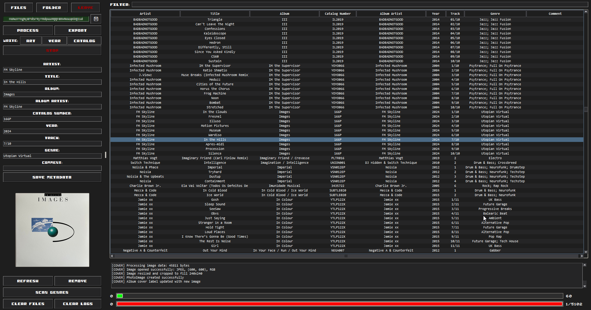
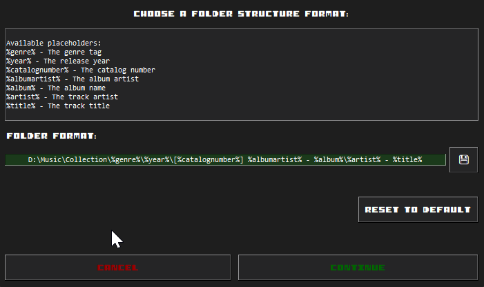
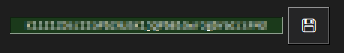

# Phonodex - Music Metadata Manager (with Automatic Metadata Fetching)



Compatible with **Windows and Linux**, with an optional **Docker browser desktop**.
The Windows installer remains unchanged. Linux and Docker run the Python source;
Docker exposes the existing Tkinter interface through noVNC, not a separate web app.

A desktop application for managing and organizing music file metadata.
By having correct Artist and Title and/or Album, it can automatically fetch the Cover Art, Catalog Number and Year.
Only these three fields are applied automatically; the rest (Genre, Comment, Track, etc.) are assumed to be filled in already or are left for you to edit.
Catalog Number and Year are fetched from the Discogs API (max. 60 calls/minute), while Album Art is retrieved from public cover-art sources.
For deeper tagging, the new **Smart Process** mode identifies the exact release from whatever tags you already have and proposes a full set of corrected tags for you to review before anything is written — see [Smart Process](#smart-process) below.

You can get a Discogs API key by doing the following:
- Log in to [Discogs](https://www.discogs.com/),
- Go to [Settings -> Developer](https://www.discogs.com/settings/developers),
- Click Generate New Token.

## Backstory

I identified the need for an automatic way to fill in certain metadata fields. I used to do all tagging manually using Discogs, so I decided to create a MP3Tag extension to do that for me.
After that was developed, I decided to turn it into an actual application with a GUI that's familiar and easy to use.
All functionality was achieved in around 10 days, and I've recently been working to turn the main.py monolith into separate modules.

**For some context**: I'm ***not*** a developer, I have no coding background except VERY basic Python usage before college, and C in college.
However, I'm naturally curious and have fun with logic and troubleshooting, so I decided to try this 'small' project using different **AI tools**.
This will explain why, for a programmer, the code will definitely have things that could be optimized or might not look logical at first. Hence, I decided to create this project on GitHub.

## Features

- 🎵 Batch edit ID3 tags and metadata for multiple audio formats (MP3, FLAC, M4A, OGG, WMA, WAV)
- 🪄 **Smart Process** — identifies the exact Discogs release from whatever tags you have and proposes a full set of corrected tags (title, artist, album, album artist, track number, year, catalog number and art) to review and approve before writing
- 🔍 Automatic metadata fetching (Album Art, Catalog Number, Year) — a quick one-click pass from just the artist and album/title
- 🚦 Automatic API request limiter (max 60 requests/minute)
- ✏️ Inline editing — double-click any cell in the table to edit it directly
- 🏷️ Genre autocomplete with an editable dictionary, plus a "Scan Genres" feature that merges genre tags found in a folder
- 🖼️ Album Art clipboard support (copy / paste / remove via right-click)
- 🔎 Live filtering across all fields and sortable columns (click a header to sort)
- 🎨 Color-coded rows (green = updated, red = failed) for quick status at a glance
- �️ Selectable **skins** (themes) that restyle the whole app — colors, fonts, progress bars and the default cover art
- �🖱️ Right-click context menu to play a file or show it in Explorer
- 📁 Exporting files from the imported folders to the final Music Collection folder
- 🔄 Drag-and-drop file support
- 📊 Visual progress tracking for both file processing and API usage

## Smart Process

Smart Process is a full *identify & tag* flow — a big step beyond the standard **PROCESS** button.

- **Works from whatever tags you have.** Instead of requiring a correct Artist and Album, it searches Discogs using any combination of the tags present (title, artist, album, year, catalog number), with the file/folder name as a fallback, and identifies the most likely release.
- **Proposes a full set of tags.** It can fill in Title, Artist, Album, Album Artist, Track Number, Year, Catalog Number and Album Art. (Genre is intentionally left untouched — use the genre dictionary/autocomplete for that.)
- **Nothing is written until you approve it.** Results open in a review window, grouped per album with one row per file. Each suggested change has its own checkbox: empty fields with a suggestion are pre-checked, while changes to fields that already have a different value stay unchecked so you opt in deliberately. You can preview the cover, switch to a different matching release, and Accept All / Reject All before saving.

Start it with the **SMART PROCESS** button (top-left of the action buttons). The standard **PROCESS** button still works exactly as before for a quick Album Art / Year / Catalog Number pass.

## Skins

Phonodex ships with selectable **skins** (themes) that restyle the entire app — all colors, the interface font, the progress-bar colors, and the default "no cover" artwork. Click the **SKINS** button (to the right of the progress bars at the bottom) to open the picker, where each skin is shown as a live preview card. Selecting one saves your choice and restarts the app to apply it.

## Supported Audio Formats
- MP3 (ID3 tags)
- FLAC
- M4A/MP4
- OGG Vorbis
- WMA (Windows Media Audio)
- WAV

## Dependencies

- tkinter / tkinterdnd2 - UI framework with drag-and-drop support
- mutagen - Audio metadata handling
- requests - API communication
- Pillow - Album art image processing and display
- pywin32 - Windows-only clipboard support for Album Art
- xclip - optional Linux system image clipboard (included in Docker)


## Installation

### Option A: Windows installer (recommended for Windows users)

Download the latest installer from the [Releases page](https://github.com/AMBIENTCORE/Phonodex/releases/tag/1.0) and run it to install Phonodex like any other desktop app. No Python setup required — it creates Start menu and optional desktop shortcuts and can launch on finish.

### Option B: Run from source (developers)

1. Clone the repository
2. Optional: Setup a virtual environment so dependencies are not installed globally:

```bash
python -m venv venv
venv\Scripts\activate
```

3. Install dependencies

```bash
pip install -r requirements.txt
```

4. Run the application:

```bash
python main.py
```

### Option C: Native Linux

On Debian/Ubuntu, install the desktop dependencies and run from a virtual environment:

```bash
sudo apt-get update
sudo apt-get install python3-venv python3-tk libfontconfig1 xclip xdg-utils
python3 -m venv .venv
. .venv/bin/activate
pip install -r requirements.txt
python main.py
```

Run this in a graphical X11 session (or a Wayland session with XWayland).
`pywin32` is installed only on Windows. Artwork copy/paste within Phonodex also
works without xclip; Linux system image copy/paste needs xclip.
Opening files uses the desktop's configured file manager and audio player.

### Option D: Docker with a browser GUI

From a checkout of this repository, with Docker Engine and Docker Compose v2:

```bash
docker compose up --build -d
docker compose ps
```

Open **http://127.0.0.1:6080/** and click **Connect**, or use
http://127.0.0.1:6080/vnc.html?autoconnect=1&resize=scale.
The container runs the same application with Xvfb, Openbox, x11vnc and noVNC.
No Windows, Wine, host display server, privileged mode or Docker socket mount is required.
The default build targets Linux and runs as UID/GID `1000:1000`.

**There is no browser authentication in this image.** Compose binds only to
localhost by default. To access a remote Docker host on a trusted LAN, explicitly
set `PHONODEX_BIND_ADDRESS` to that host's LAN address before starting Compose.
For remote/untrusted access, use a VPN or an authenticated HTTPS reverse proxy
with WebSocket support. Anyone who can access the desktop can read and change
its mounted files and saved token. Never forward this port directly to the Internet.
Raw VNC listens only on loopback inside the container and is not published.

#### Persistent folders and ownership

| Container path | Purpose |
| --- | --- |
| `/config` | Token, settings, genre dictionary, desktop state; keep private and backed up |
| `/work` | Writable working copies to import and tag |
| `/music` | Organised collection/export destination |
| `/input` (optional) | Read-only source files; copy to `/work` using the desktop file manager first |

Compose creates named volumes for `/config`, `/work` and `/music`. They survive
container replacement and `docker compose down`; **`down --volumes` deletes them**.
Alternatively, replace the `/work` and `/music` volume entries in `compose.yaml`
with your own host bind mounts. The commented `/input` example is read-only.
Create bind-mount directories first and grant the configured user the access it
needs. Phonodex never recursively changes ownership of your music.

To use different IDs, set `PHONODEX_UID` and `PHONODEX_GID` before building, for example:

```bash
PHONODEX_UID=1001 PHONODEX_GID=1001 docker compose up --build -d
```

The build arguments create the corresponding non-root account, and Compose uses
the same IDs at runtime. **Rebuild when changing IDs**; existing bind mounts and
volumes must already be writable by the new IDs. Do not change the ownership of an
existing shared library blindly; coordinate permissions with its other applications.
Do not override the container user to root.

Other Compose settings can be set in the environment or an untracked `.env` file:

| Setting | Default | Meaning |
| --- | --- | --- |
| `PHONODEX_BIND_ADDRESS` | `127.0.0.1` | Host interface to publish the browser port on |
| `PHONODEX_PORT` | `6080` | Host browser port; container port stays 6080 |
| `PHONODEX_SCREEN` | `1920x1080x24` | Virtual desktop size, minimum 1600x900, maximum 7680x4320, 24-bit colour |

Enter the Discogs token in Phonodex itself; it is saved in `/config`, not in the
Dockerfile or Compose file. Start with working copies of a small album.
Metadata lookup sends search terms to Discogs and cover-art providers; it does not
upload the audio files. No files are automatically tagged on startup.

#### Alongside Nicotine in a Proxmox CT

Run Phonodex as a **separate Docker container**, not as extra processes inside
Nicotine's container. Docker must already work in the CT. Mount the desired
Proxmox media folder into the CT using Proxmox's normal mount-point configuration,
then use that **CT-visible path** as the source of the Docker bind mount.
The Docker container cannot directly see a path that exists only on the Proxmox host.

For unprivileged CTs, account for the CT's actual UID/GID mapping when granting
host-folder permissions. Prefer a separate working directory for Phonodex so it
does not rewrite or move active downloads. Neither a privileged CT nor disabling
AppArmor is required by this image; nested Docker support is the host administrator's responsibility.
Use a different published port from Nicotine and keep their `/config` volumes separate.

#### Browser limitations and operation

- This is one shared desktop session, not a multi-user web application.
- File dialogs browse the container's mounted files. Dragging files from your PC
  onto the browser does not upload them. Drag/drop within the remote desktop works.
- Artwork copy/paste inside Phonodex and the Linux desktop is supported.
  noVNC's browser clipboard is text-only; browser-to-desktop image paste is not supported.
- Audio playback is not streamed through noVNC; use your local player.
- Skin changes restart the application in place without creating a second GUI.
- Closing Phonodex shuts down the desktop stack. With the Compose restart policy,
  it will reopen; use `docker compose stop` to stop it intentionally.

The health check requires the actual Phonodex process/window and the HTTP/VNC
services, not merely a reachable HTML page. A required-process crash stops the
stack instead of leaving a blank, apparently healthy browser desktop.

```bash
docker compose logs --tail=100
docker compose exec phonodex /usr/bin/python3 /opt/phonodex/docker/healthcheck.py
docker compose down
```

To update, fetch the desired source version and run `docker compose up --build -d`
again. Back up the persistent folders before updates; do not delete the volumes.

## Configuration

On Windows, the packaged app stores settings in `%LOCALAPPDATA%\Phonodex\`;
running from source preserves the existing project-directory behavior.
On Linux, settings live in `$XDG_CONFIG_HOME/Phonodex` or
`~/.config/Phonodex` when `XDG_CONFIG_HOME` is unset.
Set **`PHONODEX_CONFIG_DIR`** to an absolute writable directory to override either
platform (Docker uses `/config`).

- `api_key.txt` - your saved Discogs API token
- `folder_format_settings.json` - your custom export folder structure
- `genres.txt` - your editable genre dictionary (one genre per line; lines starting with `#` are comments)

This directory also holds the selected skin, saved alongside the export format.
New profiles receive a copy of the bundled genre dictionary; existing dictionaries
are never overwritten. Treat the directory as private: `api_key.txt` contains your
Discogs token in plain text. Do not commit it or bake it into an image.

The default Windows export structure is:

```
D:\Music\Collection\%genre%\%year%\[%catalognumber%] %albumartist% - %album%\%artist% - %title%
```

Linux uses the same structure under `~/Music/Collection`. Set
**`PHONODEX_LIBRARY_DIR`** to an absolute path to change the default root (Docker
uses `/music`). A saved folder format takes precedence over this default.
Use Linux paths in the container, not Windows drive letters.



You can customize this format using the following placeholders:
- %genre%
- %year%
- %catalognumber%
- %albumartist%
- %album%
- %artist%
- %title%

## Usage

1. Launch the application
2. Add your Discogs API token in the top input field, and click SAVE



3. Load files either by:
   - Clicking the "FILES" button to select individual files
   - Clicking the "FOLDER" button to select a folder
   - Dragging and dropping files into the application
4. Select the files you want to process (CTRL+A selects all files loaded)
5a. Optionally open the ▾ menu next to "PROCESS" to choose which fields to write ('art' / 'year' / 'catalog'), then click "PROCESS" for a quick automatic pass — or click "SMART PROCESS" to identify each release and review a full set of suggested tags before saving
5b. Edit metadata directly by double-clicking the field on the table **(click the Enter key to save)**, or for selected files on the left pane **(click SAVE METADATA)**
6. Use "EXPORT" to organize files into your collection

**Work on backups or copies first.** Tagging writes to the selected files.
**EXPORT moves files**, rather than creating an additional copy, and the existing
export behavior can overwrite matching destinations after confirmation. Do not
tag or move files that another application is still downloading.

### Tips

- Use the filter box above the table to quickly narrow down files, and click any column header to sort by it.
- Right-click a row to play the file or show it in Explorer; right-click the album art to copy, paste, or remove it.
- Start typing in the Genre field to get autocomplete suggestions, or use "SCAN GENRES" to merge genre tags found across a folder into your dictionary.
- Rows turn green when successfully updated and red when a fetch fails.
- Change the whole look of the app with the "SKINS" button next to the progress bars — pick a theme and Phonodex restarts to apply it.

## Contributing

Contributions are welcome!
Please feel free to submit a Pull Request.

### Offline regression checks

No API token, music downloads, or third-party test runner are needed:

```bash
python -m unittest discover -s tests -v
python -m unittest discover -s docker -p test_support.py -v
python tests/smoke_gui.py
```

The GUI smoke test creates a temporary synthetic MP3, opens the actual UI,
changes tags and artwork, saves preferences, exports the file, and checks that
the synthetic audio frames are unchanged. It does not use your music or make
metadata API requests. A display is required; headless Linux can use
`xvfb-run -a python tests/smoke_gui.py` after installing `xvfb` and `xauth`.

For Docker integration coverage, first build the image and then run:

```bash
docker compose build
python docker/smoke.py --image phonodex:local
```

This creates and removes its own disposable containers and a config volume. It
checks HTTP/WebSocket/VNC, the actual application window, non-root isolation,
recreation persistence, signal shutdown, and failure handling. It never mounts
your music. GitHub Actions runs the native tests on Windows/Linux and the Docker
smoke test on Linux.

## License

MIT
